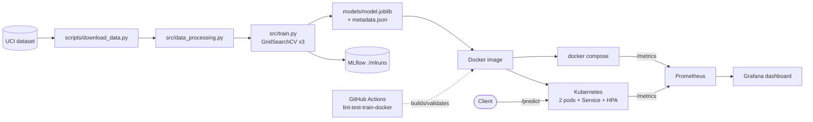

# Heart Disease Prediction - an end-to-end MLOps project

BITS Pilani AIMLCZG523 - MLOps, Assignment 1.
Repository: https://github.com/danialahmed97/heart-disease-mlops

A classifier trained on the UCI Cleveland Heart Disease dataset, tracked with MLflow, tested and built
by GitHub Actions, served by FastAPI in Docker, deployed to Kubernetes (Docker Desktop / kind), and
monitored with Prometheus + Grafana.

## Results

| Model | CV ROC-AUC | Test Acc | Precision | Recall | F1 | Test ROC-AUC |
|---|---|---|---|---|---|---|
| **LogisticRegression (selected)** | 0.902 ± 0.016 | 0.885 | 0.839 | 0.929 | 0.881 | 0.966 |
| RandomForest | 0.898 ± 0.022 | 0.902 | 0.893 | 0.893 | 0.893 | 0.956 |
| XGBoost | 0.889 ± 0.023 | 0.885 | 0.862 | 0.893 | 0.877 | 0.948 |

Details and selection rationale: [docs/model_comparison.md](docs/model_comparison.md).

## What is original here

* **Custom transformer** `ClinicalFeatureEngineer` ([src/features.py](src/features.py)): `age_group`,
  `chol_age_ratio`, `heart_rate_reserve = (220 - age) - thalach`, with clinical rationale.
* **Recall-aware model selection**: best by CV ROC-AUC, ties (within 0.005) broken by recall because
  false negatives are costlier in screening. Selection never touches the hold-out set.
* **Batch endpoint** `POST /predict/batch`, **HPA** autoscaling, **structured JSON request logs**
  with the prediction in each line, and **custom Prometheus metrics** (predictions by class,
  confidence histogram).
* **Tests run without the network** (synthetic data fixtures) and CI trains on fresh data.

## Architecture



## Repository layout

```
data/{raw,processed}  scripts/  src/  api/  models/  tests/  notebooks/  k8s/  helm/
monitoring/  reports/figures/  docs/  screenshots/  .github/workflows/ci.yml
```

## Setup (macOS arm64 / Linux, Python 3.11)

```bash
make setup                 # python3.11 -m venv .venv && pip install -r requirements-dev.txt
source .venv/bin/activate
```

Clean-venv reproduction of the model:

```bash
pip install -r requirements.txt && python scripts/download_data.py && python src/train.py
```

## Running each phase

| Phase | Command | Output |
|---|---|---|
| 1 Data + EDA | `make data` / `make eda` | `data/processed/heart_clean.csv`, `notebooks/01_eda.ipynb`, `reports/figures/*.png` |
| 2-4 Train + track + package | `make train` | `docs/model_comparison.md`, `models/model.joblib`, `models/metadata.json`, `mlruns/` |
| MLflow UI | `.venv/bin/mlflow ui --backend-store-uri ./mlruns` | http://localhost:5000 |
| CLI prediction | `python src/predict.py sample_request.json` | JSON result |
| 5 Tests | `make test` / `make lint` | 36 tests, ~97% coverage, `htmlcov/` |
| 6 Docker | `make docker-build && make docker-run` | API on :8000 |
| 7 Kubernetes | `make k8s-deploy` | namespace `heart-disease`, 2 pods, Service, HPA |
| 8 Monitoring | `make monitoring-up && make load-test` | Prometheus :9090, Grafana :3000 (admin/admin) |

## API

```bash
curl -s localhost:8000/health
curl -s -X POST localhost:8000/predict -H 'Content-Type: application/json' -d @sample_request.json
# {"prediction":0,"label":"Healthy","confidence":0.521,"probability_disease":0.479,"model_version":"1"}
curl -s localhost:8000/model-info
curl -s -X POST localhost:8000/predict/batch -H 'Content-Type: application/json' \
     -d '{"records":[{...patient...},{...patient...}]}'
```

Invalid input (e.g. `age: 999`, `thal: 5`, missing fields) returns HTTP 422. Interactive docs at `/docs`.
Prometheus metrics at `/metrics`; request logs go to stdout and `logs/api.log`.

## CI/CD

`.github/workflows/ci.yml` runs on every push / PR to `main`:
`lint (flake8)` -> `test (pytest + coverage XML/HTML, fails under 80%)` -> `train (download data, train,
upload models/ mlruns/ reports/figures as artifacts)` -> `docker (build, run, curl /health and /predict,
check 422)`. Pip caching is enabled; artifacts use `actions/upload-artifact@v4`.

## Kubernetes deployment

```bash
make k8s-deploy                       # builds image, applies k8s/, waits for rollout, curls /predict
kubectl get pods,svc,hpa -n heart-disease
helm upgrade --install hd helm/heart-disease-api -n hd-helm --create-namespace   # alternative
```

The image is built locally and referenced with `imagePullPolicy: IfNotPresent`; Docker Desktop's kind
node shares the local containerd store, so no registry is needed. The LoadBalancer IP is on Docker's
internal network, so the script verifies through `kubectl port-forward` when the IP is not
reachable from the host. HPA needs metrics-server (installed with `--kubelet-insecure-tls` on kind).

## Documentation and screenshots

* [docs/REPORT.md](docs/REPORT.md) - the full report
* [docs/SCREENSHOT_CHECKLIST.md](docs/SCREENSHOT_CHECKLIST.md) - exact screenshots to capture
* [docs/VIDEO_SCRIPT.md](docs/VIDEO_SCRIPT.md) - 6-8 minute demo script

Screenshot index: see the table in [docs/SCREENSHOT_CHECKLIST.md](docs/SCREENSHOT_CHECKLIST.md) (18 images saved to `screenshots/`).
