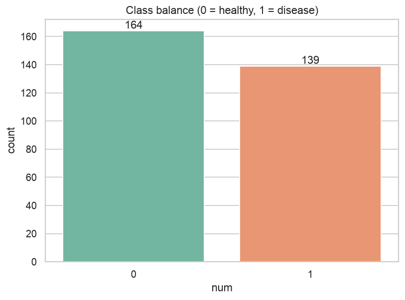
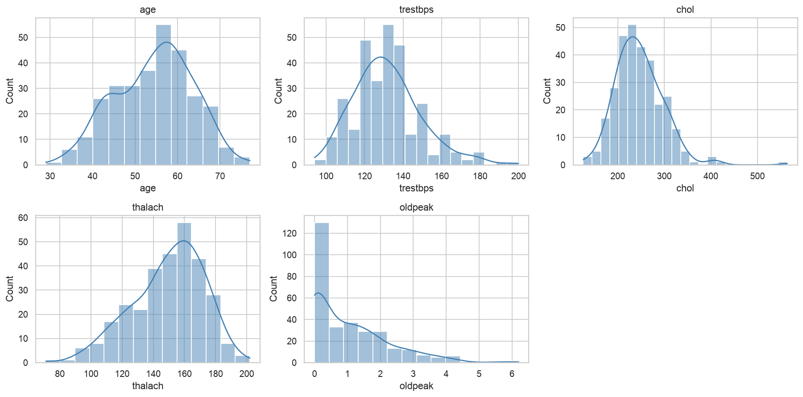
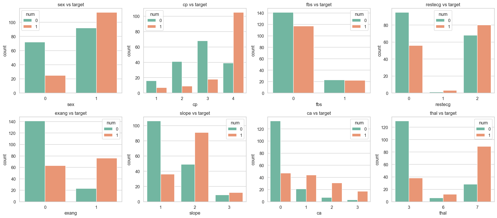
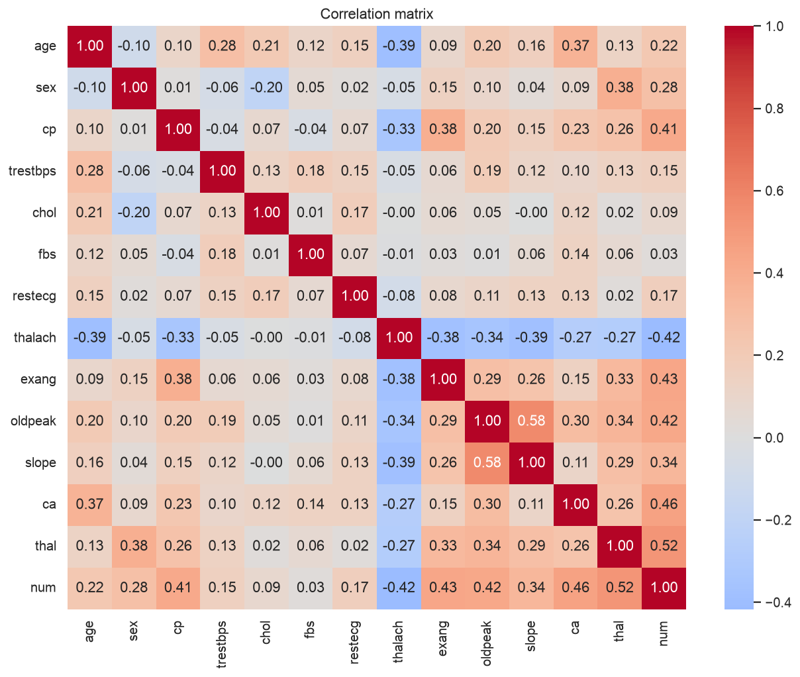
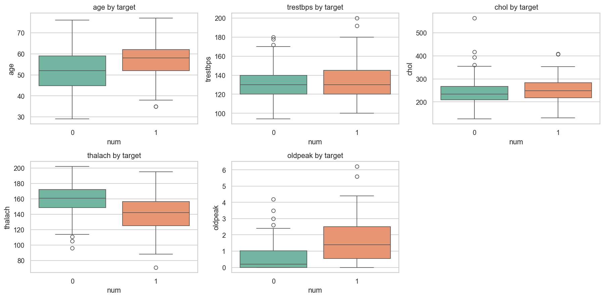
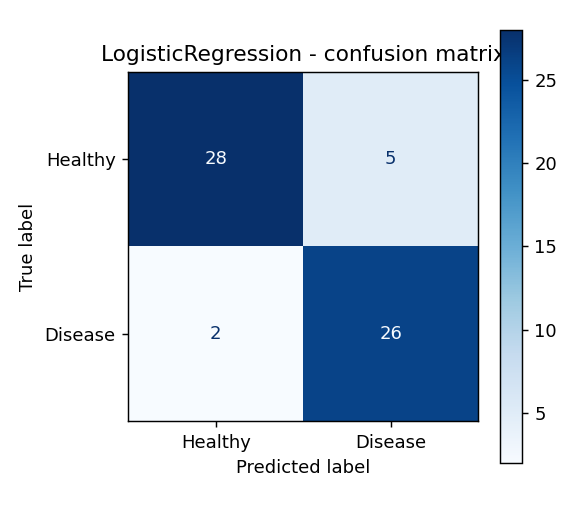
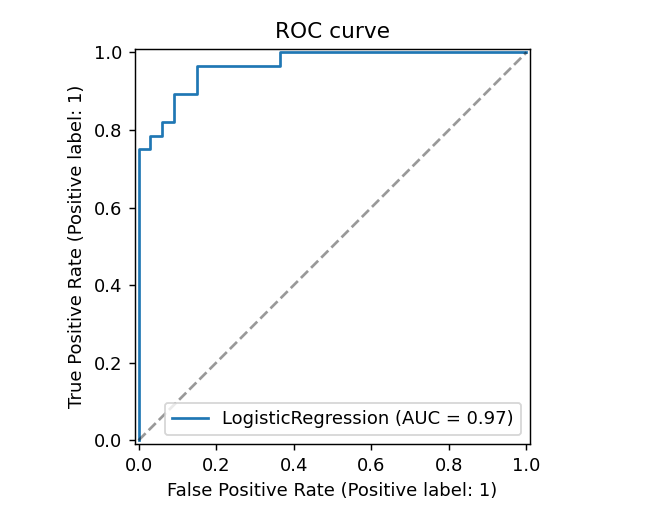
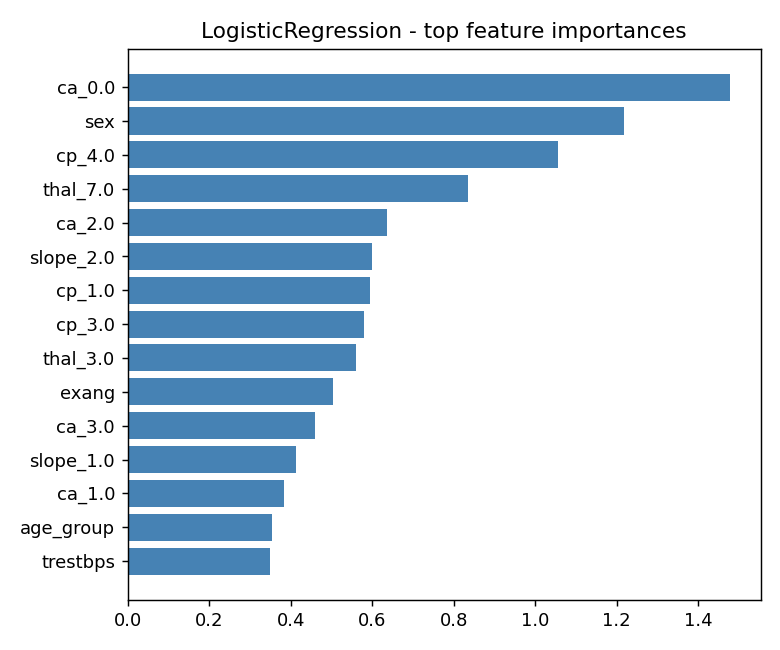
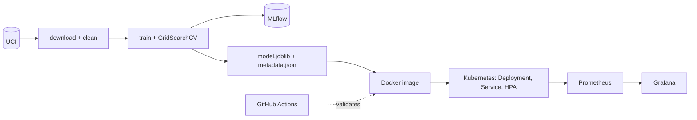

# Heart Disease Prediction: An End-to-End MLOps Pipeline

**Name:** Danial Barbhuiya

**Course:** AIMLCZG523 - MLOps

**Assignment:** Assignment 1

**Repository:** https://github.com/danialahmed97/heart-disease-mlops

<!-- pagebreak -->

## Table of Contents

1. Introduction
2. Dataset and Exploratory Data Analysis
3. Feature Engineering
4. Model Development and Tuning
5. Experiment Tracking (MLflow)
6. Packaging and Reproducibility
7. CI/CD
8. Pipeline Failure Handling
9. Containerisation
10. Kubernetes Deployment
11. Monitoring and Logging
12. Architecture
13. Challenges and Learnings
14. Limitations and Future Work
15. Conclusion

<!-- pagebreak -->

## 1. Introduction

Heart disease is a leading cause of death, and early screening relies on a handful of cheap clinical measurements. I built a binary classifier that predicts whether heart disease is present from 13 such measurements. The model is the smaller part of the work. The point of the assignment is the lifecycle around it: reproducible data processing, experiment tracking, automated tests and CI, containerisation, Kubernetes deployment and live monitoring.

I had three goals. First, a model I can defend with cross-validated numbers rather than one lucky split. Second, every step reproducible from a clean checkout with `make` targets or a single pip/python command chain. Third, a service that can be deployed, observed and scaled.

One design principle runs through everything. This is a screening use case, so a missed patient (false negative) costs more than a false alarm. Recall is therefore a first-class criterion in model selection and not an afterthought.

## 2. Dataset and Exploratory Data Analysis

### 2.1 Data and cleaning

I used the UCI Heart Disease Cleveland subset (`processed.cleveland.data`): 303 patients, 13 predictors and `num`, an angiographic severity score from 0 to 4. `scripts/download_data.py` fetches the file with four retries and exponential back-off, assigns the 14 column names and writes `data/raw/heart.csv`. `src/data_processing.py` then cleans it:

* `?` becomes NaN. Only `ca` (4 rows) and `thal` (2 rows) are affected, under 2% of the data. I imputed both with the column mode. Both are categorical, so the mode is the natural fill, and imputing keeps all 303 rows.
* Discrete columns are cast to integers; `oldpeak` stays float.
* `num > 0` becomes 1 (disease present). This turns the five-level severity into the screening question "disease or not".
* Duplicate rows are dropped; none were found.

The result is 303 rows with 164 healthy and 139 diseased patients. The cleaning functions are small and individually unit-tested.

### 2.2 Summary statistics

| Feature | Mean | Std | Min | Max | IQR outliers |
|---|---|---|---|---|---|
| age | 54.4 | 9.0 | 29 | 77 | 0 |
| trestbps | 131.7 | 17.6 | 94 | 200 | 9 |
| chol | 246.7 | 51.8 | 126 | 564 | 5 |
| thalach | 149.6 | 22.9 | 71 | 202 | 1 |
| oldpeak | 1.0 | 1.2 | 0.0 | 6.2 | 5 |

The sample is 68% male (206 of 303) and only 15% have raised fasting blood sugar (45 of 303). The outlier counts are small (1.5 x IQR rule). The single `chol` value of 564 is extreme but physiologically possible, so I kept it. Standard scaling plus a regularised model keeps its influence limited.

### 2.3 Class balance

The classes are close to balanced (54% / 46%). Accuracy is therefore meaningful, but I still optimise ROC-AUC and watch recall because they match the screening objective. With this balance, resampling or class weights are not required; I only keep `class_weight` as a tunable option for logistic regression.

### 2.4 Distributions

`chol` (skew about 1.1) and `oldpeak` (about 1.3) are right-skewed, while `thalach` (about -0.5) leans left. `age` and `trestbps` are roughly bell-shaped. The skew justifies scaling for the linear model. I did not log-transform, because the tree models do not need it and logistic regression with standardised inputs was already competitive.

### 2.5 Categorical features against the target

These plots carry most of the signal.

* **Chest pain type:** about 73% of patients with asymptomatic chest pain (`cp` = 4) have disease, against 18-30% for the other three types. This is counter-intuitive but well known in this dataset.
* **Exercise angina:** 77% disease with `exang` = 1, against 31% without.
* **Major vessels (`ca`):** prevalence climbs from 26% at 0 vessels to 68%, 82% and 85% at 1, 2 and 3.
* **`thal`:** 23% for normal (3), 67% for fixed defect (6) and 76% for reversible defect (7).
* **`slope`:** 25% for the up-sloping value 1, against about 60% for values 2 and 3.
* **`fbs`:** 45% against 49%, which is practically no signal. I kept it because it costs nothing and the model can ignore it.
* **Sex:** 55% disease in men against 26% in women. Age shows a similar trend: 33% under 40, 30% for 40-49, 51% for 50-59 and 56% for 60 and above.

The age pattern is what motivated the `age_group` feature described in section 3.

### 2.6 Correlations

The strongest correlates of the target are `thal` (0.52), `ca` (0.46), `exang` (0.43), `oldpeak` (0.42), `cp` (0.41) and `thalach` (-0.42). No two predictors are highly collinear, so I keep all 13. Note that `cp`, `thal`, `ca` and `slope` are nominal or ordinal codes, so their Pearson values are only a rough guide, which is why they are one-hot encoded in the model.

### 2.7 Numeric features by target

Diseased patients reach a much lower maximum heart rate (mean 139 against 158) and show higher ST depression (1.6 against 0.6). `chol` and `trestbps` overlap heavily between the groups and are weak signals, as the correlation matrix already suggested. The `thalach` gap is the second hint behind the `heart_rate_reserve` feature.

[SCREENSHOT: eda_notebook.png]

## 3. Feature Engineering

`src/features.py` builds one scikit-learn `Pipeline`: `ClinicalFeatureEngineer -> ColumnTransformer -> estimator`.

| Group | Columns | Treatment |
|---|---|---|
| Numeric | age, trestbps, chol, thalach, oldpeak + 3 engineered | `StandardScaler` |
| Categorical | cp, restecg, slope, thal, ca | `OneHotEncoder(handle_unknown="ignore")` |
| Binary | sex, fbs, exang | passthrough |

### 3.1 Custom transformer (original contribution)

`ClinicalFeatureEngineer` is a `BaseEstimator`/`TransformerMixin` that appends three domain features.

* **`age_group`** buckets age into under 40, 40-49, 50-59 and 60+. The EDA shows disease prevalence stepping up from about 30% to above 50% between the 40s and 50s. A linear term in raw age cannot express that step.
* **`chol_age_ratio`** is cholesterol divided by age. The same cholesterol level is more alarming in a younger patient, and the ratio puts both on one scale.
* **`heart_rate_reserve`** is `(220 - age) - thalach`: the gap between the age-predicted maximum heart rate and the rate actually reached. A large reserve means the patient could not reach the expected exertion, a recognised marker of ischaemia. It combines two columns that the EDA already flags as informative.

### 3.2 Why a pipeline

Because the transformer lives inside the pipeline, training, the CLI, the API and the container run identical code, so there is no training-serving skew. The transformer is stateless, never mutates its input and is unit-tested for values, bucket edges and unknown categories. `OneHotEncoder(handle_unknown="ignore")` means a category unseen at training time yields an all-zero block instead of a crash. All inputs are cast to float64 at load time so the schema is the same in training and in the API.

## 4. Model Development and Tuning

### 4.1 Protocol

I split the data once, stratified 80/20 with `random_state=42` (242 train, 61 test). Every model is tuned with `GridSearchCV` on the training portion only, using 5-fold `StratifiedKFold` (shuffled, seed 42) and ROC-AUC as the score. The best estimator is refit on the full training split and evaluated once on the test set.

### 4.2 Hyperparameter grids

| Model | Grid | Combinations | Fits (x5 folds) |
|---|---|---|---|
| LogisticRegression | C in {0.01, 0.1, 1, 10}; class_weight in {None, balanced}; penalty l2 | 8 | 40 |
| RandomForest | n_estimators in {100, 300}; max_depth in {3, 5, None}; min_samples_leaf in {1, 3} | 12 | 60 |
| XGBoost | n_estimators in {100, 200}; max_depth in {2, 3, 4}; learning_rate in {0.03, 0.1} | 12 | 60 |

The grids are small on purpose. With 242 training rows a large search mostly overfits the CV folds. If XGBoost cannot be imported, `GradientBoostingClassifier` is used automatically.

### 4.3 Cross-validation results: top configurations

| Model | Rank | Parameters | CV ROC-AUC (mean ± std) |
|---|---|---|---|
| LogisticRegression | 1 | C=1, class_weight=None | 0.9018 ± 0.0156 |
| LogisticRegression | 2 | C=1, class_weight=balanced | 0.9004 ± 0.0155 |
| LogisticRegression | 3 | C=10, class_weight=None | 0.8978 ± 0.0165 |
| RandomForest | 1 | depth=3, leaf=3, trees=300 | 0.8976 ± 0.0215 |
| RandomForest | 2 | depth=3, leaf=3, trees=100 | 0.8959 ± 0.0229 |
| RandomForest | 3 | depth=3, leaf=1, trees=300 | 0.8959 ± 0.0209 |
| XGBoost | 1 | lr=0.03, depth=2, trees=100 | 0.8889 ± 0.0225 |
| XGBoost | 2 | lr=0.03, depth=2, trees=200 | 0.8851 ± 0.0192 |
| XGBoost | 3 | lr=0.03, depth=3, trees=200 | 0.8757 ± 0.0186 |

The worst grid cell per family was 0.870 (LogisticRegression, strongest regularisation), 0.884 (RandomForest) and 0.856 (XGBoost). Two patterns stand out. The best tree models are the shallowest and the best boosted model uses the smallest learning rate and depth: the data is small, so low capacity wins. And balanced class weights made no real difference, which agrees with the near-balanced classes.

### 4.4 Test-set results

| Model | CV ROC-AUC | Test Acc | Precision | Recall | F1 | Test ROC-AUC |
|---|---|---|---|---|---|---|
| **LogisticRegression** | 0.902 ± 0.016 | 0.885 | 0.839 | 0.929 | 0.881 | 0.966 |
| RandomForest | 0.898 ± 0.022 | 0.902 | 0.893 | 0.893 | 0.893 | 0.956 |
| XGBoost | 0.889 ± 0.023 | 0.885 | 0.862 | 0.893 | 0.877 | 0.948 |

### 4.5 Selection rule and result

The winner is the model with the highest cross-validated ROC-AUC. Models within 0.005 AUC of the best count as tied, and the one with higher test recall is chosen. I select on CV rather than on test AUC so the hold-out set stays an unbiased estimate. LogisticRegression wins: best CV AUC and best recall (26 of 28 diseased patients found, 2 missed, 5 false alarms among 33 healthy patients).

I want to be honest about the margin. The gap between logistic regression and the tree models (0.004 to 0.013 AUC) is smaller than one CV standard deviation (about 0.02). The fair reading is that three models are comparable on this small dataset, and the simplest and most interpretable one wins. The test set has only 61 rows, so one patient moves a metric by about 1.6 points. That is why decisions rest on CV, not on the test table.

The largest absolute coefficients of the final model are `ca = 0` (protective), `sex`, `cp = 4` and `thal = 7` (reversible defect). These match what the EDA showed.

## 5. Experiment Tracking (MLflow)

`src/train.py` logs to the experiment `heart-disease-classification`, stored locally in `./mlruns`. Each of the three runs records the following.

* **Parameters:** the best hyperparameters found by the grid search.
* **Metrics:** CV mean and std of ROC-AUC, and test accuracy, precision, recall, F1 and ROC-AUC.
* **Artifacts:** confusion-matrix, ROC and precision-recall PNGs, a feature-importance plot (absolute coefficients or impurity importances), and a classification report text file.
* **Model:** the full pipeline through `mlflow.sklearn.log_model`, with an inferred **signature** and an **input example**.

The best run is tagged `best_model=true` and registered as `heart-disease-classifier` with the alias `champion`.

### 5.2 Model registry and versioning

Each training run registers its best model under the name `heart-disease-classifier`, which creates a new version. I trained twice, so the registry shows **2 versions** of `heart-disease-classifier`, one per training run. After each run the `champion` alias is moved to the newly registered version, so it now points to the latest version (**v2**) and v1 stays available as the earlier version. This demonstrates both versioning (every run is kept and traceable to its MLflow run) and alias promotion (consumers ask for "champion" instead of a hard-coded version number, and promotion or rollback is just moving the alias). The version number is also written to `models/metadata.json` and returned as `model_version` by the API.

### 5.1 Run comparison

| Run | Model | CV AUC | CV std | Test Acc | Precision | Recall | F1 | Test AUC | Tag |
|---|---|---|---|---|---|---|---|---|---|
| 0a463502 | LogisticRegression | 0.9018 | 0.0155 | 0.8852 | 0.8387 | 0.9285 | 0.8813 | 0.9664 | best_model |
| d72afd19 | RandomForest | 0.8975 | 0.0215 | 0.9016 | 0.8928 | 0.8928 | 0.8928 | 0.9556 | - |
| 7e772201 | XGBoost | 0.8888 | 0.0225 | 0.8852 | 0.8620 | 0.8928 | 0.8771 | 0.9480 | - |

Run IDs are shortened and change when the experiment is re-run; the numbers do not, because every seed is fixed. Having all three runs in one table with plots attached made the comparison a one-click task in the MLflow UI and kept the choice auditable.

[SCREENSHOT: mlflow_runs.png]

[SCREENSHOT: mlflow_best_run.png]

[SCREENSHOT: mlflow_model_registry.png]

## 6. Packaging and Reproducibility

* **Model artifact:** `models/model.joblib` holds the entire pipeline (features, preprocessing, estimator). `models/metadata.json` stores the model name, version, metrics, hyperparameters, feature list, training date and scikit-learn version.
* **Seeds:** Python, NumPy and `PYTHONHASHSEED` are set, and every estimator, splitter and CV object gets `random_state=42`.
* **Pinned dependencies:** `requirements.txt` pins exact versions. My first environment came with pandas 3.x and NumPy 2.4. I replaced them with a conservative, mutually tested set (NumPy 1.26.4, pandas 2.2.3, scikit-learn 1.5.2, XGBoost 2.1.3, MLflow 2.17.2) and confirmed `pip check` is clean. `requirements-dev.txt` adds pytest, pytest-cov, flake8, black, httpx and the report-builder libraries.
* **Clean-venv check:** I verified `pip install -r requirements.txt && python scripts/download_data.py && python src/train.py` in a brand-new virtual environment. `train.py` rebuilds the processed CSV itself if it is missing, so the documented command chain works even without the data-cleaning step.
* **Tooling:** a `Makefile` exposes `setup data train test lint docker-build docker-run k8s-deploy monitoring-up load-test`, and `src/predict.py` is a CLI for JSON or CSV input.

## 7. CI/CD

The workflow `.github/workflows/ci.yml` runs on every push and pull request to `main`, with a concurrency group so a newer push cancels an older run of the same ref. Jobs are chained with `needs`, so the pipeline fails fast and later (more expensive) jobs never run on broken code.

### 7.1 Job by job

1. **Lint (flake8).** Installs only flake8, then checks `src api scripts tests` with the rules in `.flake8` (max line length 100). It takes seconds and catches style and syntax errors before anything else.
2. **Unit tests + coverage.** Installs the dev requirements (pip-cached), then runs pytest with `--cov-fail-under=80`. It writes coverage XML and HTML and uploads them with `actions/upload-artifact@v4` even if the job fails, so the reports are always available.
3. **Train model.** Downloads the data from UCI, runs `python src/train.py` and uploads `models/`, `mlruns/`, `reports/figures/` and the model-comparison document. This proves the training path works on a clean runner and gives every commit a reproducible model artifact.
4. **Docker build + smoke test.** Downloads the freshly trained model, copies it into `models/`, builds the image, runs the container, polls `/health` for up to 60 seconds, posts `sample_request.json` to `/predict` and validates the response, and finally checks that an invalid body returns 422. It always prints the container logs at the end.

### 7.2 Tests

There are 36 tests in `tests/`.

* `test_data_processing.py` covers '?' handling, mode imputation, binarisation, type casting, duplicate removal and the file round trip.
* `test_features.py` covers engineered values, age buckets, no input mutation, pipeline output names and unknown categories.
* `test_model.py` covers selection logic (recall tiebreak and clear AUC winner), metrics, the prediction CLI, and an end-to-end `train.main` run with and without MLflow on synthetic data.
* `test_api.py` uses FastAPI's `TestClient` for `/health`, valid `/predict`, six parametrised out-of-range cases, a missing field, a wrong type, batch, an empty batch, and the `/metrics` endpoint.

Coverage is about 97%. The tests build their own small model from synthetic data with the real schema, so they need neither network access nor the committed model.

[SCREENSHOT: pytest_coverage.png]

[SCREENSHOT: github_actions_green.png]

[SCREENSHOT: github_actions_artifacts.png]

## 8. Pipeline Failure Handling

A pipeline is only trustworthy if it fails when it should. To demonstrate this I created a throwaway branch, `demo/ci-failure`, with one deliberately wrong test: it posts a valid patient to `/predict` and asserts that the predicted class equals 2, which is impossible for a binary classifier. I opened a draft pull request against `main` to trigger the workflow (pushes to other branches do not trigger it), and left `main` untouched.

The result:

* **Lint** passed.
* **Unit tests + coverage** failed with `assert 0 == 2` (`1 failed, 36 passed`).
* **Train model** and **Docker build + smoke test** were skipped because of the `needs` chain, so no model was trained and no image built from the broken commit.

The failed run is at https://github.com/danialahmed97/heart-disease-mlops/actions/runs/39131770605. Afterwards I closed the PR without merging and deleted the branch locally and on the remote.

This shows three properties I wanted: failures are visible in the first job that can detect them, the chain stops there, and the log points at the exact assertion.

[SCREENSHOT: github_actions_failed.png]

## 9. Containerisation

### 9.1 Service

`api/main.py` (FastAPI) loads the model once at start-up through a lifespan handler and exposes:

* `POST /predict` returning `{prediction, label, confidence, probability_disease, model_version}`;
* `POST /predict/batch` for up to 500 patients (my extra endpoint);
* `GET /health`, `GET /model-info` and `GET /metrics`.

A Pydantic model validates every input against clinical ranges (for example age 18-120, `cp` 1-4, `ca` 0-3, and `thal` limited to 3, 6 or 7). Violations return HTTP 422 before the model is ever called. `confidence` is the probability of the predicted class, `max(p, 1 - p)`.

### 9.2 Image

The `Dockerfile` is multi-stage. A builder stage creates a virtual environment from a minimal `requirements-api.txt` (no Jupyter or MLflow), and the runtime stage is a clean `python:3.11-slim` with only that environment, `src/`, `api/` and `models/`. It installs `libgomp1` for XGBoost, runs as a **numeric non-root user (UID 10001)**, defines a `HEALTHCHECK` against `/health`, and starts uvicorn on port 8000. `.dockerignore` keeps data, notebooks, tests and manifests out of the build context. The image is built for `linux/arm64` locally and for amd64 in CI.

The model pickle refers to `src.features.ClinicalFeatureEngineer`, so the `src` package must be inside the image at the same import path.

[SCREENSHOT: docker_build.png]

[SCREENSHOT: docker_curl.png]

[SCREENSHOT: api_docs.png]

[SCREENSHOT: api_422.png]

## 10. Kubernetes Deployment

I deployed to the Kubernetes cluster that Docker Desktop provisions with kind (context `docker-desktop`).

### 10.1 Manifest walkthrough

* **`namespace.yaml`** creates the `heart-disease` namespace to isolate the app.
* **`deployment.yaml`**
  * 2 replicas with a rolling update (`maxUnavailable: 0`, `maxSurge: 1`), so a rollout never reduces capacity.
  * `imagePullPolicy: IfNotPresent` and the local image `heart-disease-api:latest`.
  * Readiness and liveness probes on `/health`. Readiness (5 s delay, 5 s period) keeps traffic away from a pod that has not loaded the model yet; liveness (15 s, 10 s) restarts a hung pod.
  * Requests of 100m CPU / 256Mi and limits of 500m / 512Mi, so the scheduler can place pods and one pod cannot starve others.
  * Prometheus annotations (`prometheus.io/scrape`, `path`, `port`).
  * A security context with `runAsNonRoot`, `runAsUser: 10001` and no privilege escalation.
* **`service.yaml`** is a `LoadBalancer` service on port 80, forwarding to the named container port `http`.
* **`ingress.yaml`** is optional and needs an ingress controller, which is not installed in this cluster.
* **`hpa.yaml`** scales between 2 and 5 pods at 60% average CPU (my extra). It needed metrics-server, which I installed with `--kubelet-insecure-tls` because kind uses self-signed kubelet certificates. The HPA now reports a real figure (3% idle).

An equivalent Helm chart lives in `helm/heart-disease-api`. Replicas, image, resources, probes, autoscaling and ingress are values, and the namespace comes from the release. `helm lint` is clean and I installed and removed a test release.

### 10.2 Deploy script

`scripts/deploy_k8s.sh` builds the image, applies the manifests, restarts the deployment, waits for the rollout and then calls `/health` and `/predict` through the service. The LoadBalancer receives an address on Docker's internal network (172.18.x.x) that macOS cannot route to, so the script tests that address with a short timeout and otherwise falls back to `kubectl port-forward`.

[SCREENSHOT: k8s_pods.png]

[SCREENSHOT: k8s_predict.png]

[SCREENSHOT: helm_install.png]

## 11. Monitoring and Logging

### 11.1 Logs

A middleware writes one JSON line per request with timestamp, method, path, status, `latency_ms` and, for predictions, the predicted label. Lines go to stdout (picked up by `docker logs` and `kubectl logs`) and to `logs/api.log`. If the log directory is not writable, file logging is disabled with a warning instead of crashing the service.

### 11.2 Metrics

| Metric | Type | Source | What it answers |
|---|---|---|---|
| `http_requests_total{handler,method,status}` | counter | instrumentator | request rate and error ratio |
| `http_request_duration_highr_seconds` | histogram | instrumentator | p95 latency |
| `heart_predictions_total{label}` | counter | custom | class mix of predictions |
| `heart_prediction_confidence` | histogram | custom | how sure the model is |

The two custom metrics are the model-level signals. A sudden swing in the Healthy/Disease mix or a drop in confidence is an early hint of input drift, even without ground-truth labels.

### 11.3 Stack and dashboard

`monitoring/docker-compose.yml` starts the API, Prometheus (5 s scrape interval) and Grafana with a provisioned data source and dashboard. The five panels are:

1. **Request rate**: `sum by (handler) (rate(http_requests_total[1m]))`.
2. **p95 latency**: `histogram_quantile(0.95, sum by (le) (rate(http_request_duration_highr_seconds_bucket[1m])))`.
3. **Error rate**: the share of 4xx and 5xx responses among all requests.
4. **Predictions by class**: `increase(heart_predictions_total[1m])` per label.
5. **Confidence distribution**: the cumulative confidence histogram buckets.

### 11.4 Load test

`scripts/load_test.py` sends about 200 varied requests, 5% of them deliberately invalid so the error panel has something to show. One run produced 189 responses with status 200 and 11 with 422, with 133 Disease and 56 Healthy predictions. Prometheus showed the target UP, p95 latency around 20 ms and an error ratio around 3%.

[SCREENSHOT: prometheus_targets.png]

[SCREENSHOT: grafana_dashboard.png]

[SCREENSHOT: api_logs.png]

## 12. Architecture

Data flows left to right. The same image runs under Docker Compose and under Kubernetes, and both expose `/metrics` for Prometheus. CI validates the code path from lint to a running container but does not push the image to a registry or deploy it.

## 13. Challenges and Learnings

* **Dependency compatibility.** The default environment had pandas 3.x and NumPy 2.4. Pinning to a tested set avoided binary and API surprises with scikit-learn, XGBoost and MLflow.
* **Pickled custom class.** `model.joblib` references `src.features.ClinicalFeatureEngineer`, so the image has to ship the `src` package, and `train.py` must import it under that module path.
* **Kubernetes non-root check.** The first deployment failed with `CreateContainerConfigError` because the image user was the name `appuser`, which Kubernetes cannot verify as non-root. Switching to numeric UID 10001 fixed it.
* **LoadBalancer on kind.** The assigned IP is not routable from macOS, so the script falls back to port-forward. The HPA showed `<unknown>` until metrics-server was installed.
* **Workflow triggers.** My CI only triggers on `main` and pull requests to `main`, so the failure demo needed a draft PR. The concurrency setting also cancelled some intermediate runs when I pushed quickly.
* **Small data.** With 61 test patients, one prediction moves a metric by about 1.6 points. I therefore based conclusions on CV with its standard deviation, not on the test table.
* **Image availability.** Docker Desktop's kind node shares the local containerd store, so the locally built image was found without a registry. `IfNotPresent` prevents needless pulls.

## 14. Limitations and Future Work

**Limitations**

* One hospital, 303 patients, no external validation. The results say little about how the model would behave on other populations.
* The 61-row test set gives wide confidence intervals; the model ranking is not statistically established.
* The default 0.5 threshold is not tuned for a target recall, even though recall is the stated priority.
* There are no per-feature drift checks and no ground-truth feedback loop, so monitoring covers service health and prediction mix but not accuracy over time.
* MLflow runs on a local file store; there is no shared tracking server, and `mlruns/` is not in git.
* CI builds and tests the image but does not publish it to a registry, and the deployment is manual.
* This is a teaching project and not a clinical device.

**Future work**

* Calibrate probabilities and choose a threshold for a target recall (for example 95%).
* Add input-drift detection (population stability index per feature) exported as Prometheus metrics, with alerts in Grafana.
* Validate on the Hungarian, Swiss and VA subsets of the UCI data.
* Push images to a registry from CI and deploy by promoting the MLflow `champion` alias.
* Move MLflow to a server with a database backend and artifact store.
* Add SHAP explanations to `/predict` responses.

## 15. Conclusion

The project delivers a validated screening model (CV AUC 0.90, test recall 0.93) and, around it, a reproducible, tested, containerised, orchestrated and monitored service. Every stage is automated through `make` targets or CI, and every claim in this report has evidence in the repository: the notebook and figures, the model-comparison document, the MLflow runs, the test and coverage output, the CI runs (including a deliberate failure), the Kubernetes manifests and the Grafana dashboard. The biggest lesson was that most of the effort and most of the bugs sat around the model (packaging, security context, networking, dependencies), not in the model itself.
