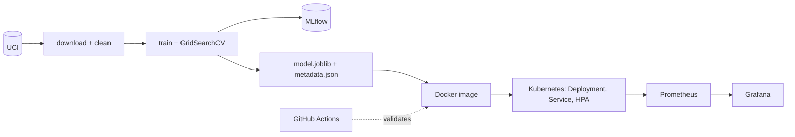

# Heart Disease Prediction: an End-to-End MLOps Pipeline

**Course:** AIMLCZG523 - MLOps, BITS Pilani - Assignment 1
**Repository:** https://github.com/danialahmed97/heart-disease-mlops

---

## 1. Introduction

Heart disease is a leading cause of death, and early screening depends on a handful of inexpensive
clinical measurements. This project builds a binary classifier that predicts the presence of heart
disease from 13 such measurements, and - more importantly for this course - wraps it in a complete,
reproducible MLOps lifecycle: versioned data processing, experiment tracking, automated tests and CI,
containerisation, Kubernetes deployment and live monitoring.

Goals: (1) a defensible model, (2) every step reproducible from a clean checkout, (3) a service that
can be deployed, observed and scaled. Design choices throughout favour *medical-screening* semantics:
a missed patient (false negative) is worse than a false alarm, so recall is a first-class criterion.

## 2. Dataset and Exploratory Data Analysis

**Data.** The UCI Heart Disease *Cleveland* subset (`processed.cleveland.data`): 303 patients, 13
predictors plus `num` (0-4 angiographic severity). `scripts/download_data.py` downloads it with
retry/back-off and logging; `src/data_processing.py` cleans it:

* `?` -> NaN; `ca` (4 missing) and `thal` (2 missing) imputed with the column mode (< 2 % of rows;
  both are categorical, so the mode is the natural fill);
* discrete columns cast to int; `num > 0` -> 1 (disease present);
* duplicate rows dropped (none found). Result: 303 rows, 164 healthy / 139 diseased.

**EDA** (`notebooks/01_eda.ipynb`, figures in `reports/figures/`).

The classes are nearly balanced (54 % / 46 %), so accuracy is meaningful, but ROC-AUC and recall are
still used because they reflect screening needs.

`chol` and `oldpeak` are right-skewed (skew about 1.1 and 1.3), `thalach` is left-skewed; scaling is
therefore applied for the linear model.

Disease prevalence is about 73 % for asymptomatic chest pain (`cp` = 4) against 18-30 % for other types,
77 % with exercise-induced angina and rises from 26 % (0 vessels) to 85 % (3 vessels) with `ca`.

The strongest correlates of the target are `thal` (0.52), `ca` (0.46), `exang` (0.43), `oldpeak` (0.42),
`cp` (0.41) and `thalach` (-0.42). No pair of predictors is highly collinear.

Diseased patients reach a much lower maximum heart rate (mean 139 vs 158) and show higher ST depression
(1.6 vs 0.6). `chol` and `trestbps` overlap heavily and are weak signals.

[SCREENSHOT: eda_notebook.png]

## 3. Feature Engineering

`src/features.py` builds one `sklearn` pipeline: `ClinicalFeatureEngineer -> ColumnTransformer -> model`.

| Group | Columns | Treatment |
|---|---|---|
| Numeric | age, trestbps, chol, thalach, oldpeak + 3 engineered | `StandardScaler` |
| Categorical | cp, restecg, slope, thal, ca | `OneHotEncoder(handle_unknown="ignore")` |
| Binary | sex, fbs, exang | passthrough |

**Original contribution - `ClinicalFeatureEngineer`** (a custom `BaseEstimator`/`TransformerMixin`):

* `age_group` (bucket <40, 40-49, 50-59, 60+): cardiac risk rises non-linearly by decade, which a
  linear term in raw age cannot express.
* `chol_age_ratio` = chol / age: the same cholesterol is more alarming in a younger patient.
* `heart_rate_reserve` = (220 - age) - thalach: distance between the age-predicted maximum heart rate
  and the rate actually achieved; large reserve (inability to reach expected exertion) is a recognised
  ischaemia marker, and it combines two columns the correlation heatmap already flags as informative.

Because the transformer lives inside the pipeline, the *same* code runs in training, the CLI, the API and
the container; there is no training/serving skew. Unknown categories at inference are ignored rather
than crashing. The transformer is stateless and does not mutate its input (unit-tested).

## 4. Model Development and Tuning

The data are split stratified 80/20 (`random_state=42`: 242 train / 61 test). For each of three models
a 5-fold `StratifiedKFold` `GridSearchCV` optimises ROC-AUC on the training portion only:

* LogisticRegression - `C`, `class_weight`;
* RandomForest - `n_estimators`, `max_depth`, `min_samples_leaf`;
* XGBoost - `n_estimators`, `max_depth`, `learning_rate` (GradientBoosting is the automatic fallback
  if XGBoost cannot be imported).

| Model | CV ROC-AUC | Test Acc | Precision | Recall | F1 | Test ROC-AUC |
|---|---|---|---|---|---|---|
| **LogisticRegression** | 0.902 ± 0.016 | 0.885 | 0.839 | 0.929 | 0.881 | 0.966 |
| RandomForest | 0.898 ± 0.022 | 0.902 | 0.893 | 0.893 | 0.893 | 0.956 |
| XGBoost | 0.889 ± 0.023 | 0.885 | 0.862 | 0.893 | 0.877 | 0.948 |

**Selection rule.** Highest *cross-validated* ROC-AUC wins; models within 0.005 AUC are considered tied
and the one with the higher recall is chosen. Using CV rather than test AUC keeps the hold-out set an
unbiased estimate. LogisticRegression is selected: best CV AUC and best recall (26 of 28 diseased
patients found; 2 missed, 5 false alarms).

The advantage over the tree models is within one standard deviation of CV noise, so the honest reading
is "three models are comparable on this small dataset"; the simplest, most interpretable one wins.
Its largest coefficients are `ca = 0` (protective), `sex`, `cp = 4`, and `thal = 7` (reversible defect),
matching the EDA.

## 5. Experiment Tracking (MLflow)

`src/train.py` logs to the experiment `heart-disease-classification` (local store `./mlruns`). Each of
the three runs records: hyperparameters, CV mean/std and the five test metrics, confusion-matrix, ROC and
precision-recall PNGs, a feature-importance plot (coefficients or impurity importances), a
classification report, and the full pipeline via `mlflow.sklearn.log_model` with an inferred
**signature** and an **input example**. The best run is tagged `best_model=true` and registered as
`heart-disease-classifier` with alias `champion`.

[SCREENSHOT: mlflow_runs.png]
[SCREENSHOT: mlflow_best_run.png]
[SCREENSHOT: mlflow_model_registry.png]

## 6. Packaging and Reproducibility

* `models/model.joblib` holds the **entire** pipeline (features + preprocessing + estimator) and
  `models/metadata.json` records model name, version, metrics, hyperparameters, feature list, training
  date and scikit-learn version.
* Seeds are fixed (Python, NumPy, `PYTHONHASHSEED`, every estimator, splitter and CV).
* `requirements.txt` pins exact versions. The first environment came with pandas 3.x / NumPy 2.4,
  which were replaced by a conservative, mutually tested set (NumPy 1.26.4, pandas 2.2.3,
  scikit-learn 1.5.2, XGBoost 2.1.3, MLflow 2.17.2); `pip check` is clean.
* Verified from a brand-new venv: `pip install -r requirements.txt && python scripts/download_data.py
  && python src/train.py`. `train.py` rebuilds the processed CSV itself if it is missing.
* A `Makefile` exposes `setup data train test lint docker-build docker-run k8s-deploy monitoring-up
  load-test`; `src/predict.py` offers a CLI for JSON or CSV input.

## 7. CI/CD

GitHub Actions (`.github/workflows/ci.yml`) on every push and pull request to `main`:

1. **lint** - flake8 (configuration in `.flake8`);
2. **test** - pytest with coverage XML/HTML, failing below 80 %; reports uploaded as an artifact;
3. **train** - downloads data, trains, uploads `models/`, `mlruns/`, `reports/figures/`;
4. **docker** - downloads the freshly trained model, builds the image, runs the container, polls
   `/health`, posts `sample_request.json` to `/predict`, and checks that bad input yields 422.

Jobs are chained with `needs`, so a failure stops the pipeline early. pip caching keeps runs fast.

**Tests.** 36 tests (`tests/`) cover data cleaning, the transformer (values, buckets, no mutation,
unknown categories), selection logic, the CLI, an end-to-end `train.main` run (with and without MLflow)
and the API (`/health`, valid and invalid `/predict`, batch, metrics). Coverage is about **97 %**.
Tests use synthetic data with the real schema, so they need neither network nor the committed model.

[SCREENSHOT: pytest_coverage.png]
[SCREENSHOT: github_actions_green.png]
[SCREENSHOT: github_actions_artifacts.png]

## 8. Containerisation

`api/main.py` (FastAPI) loads the model once at start-up (lifespan handler) and exposes
`POST /predict`, `POST /predict/batch` (originality; up to 500 records), `GET /health`,
`GET /model-info` and `GET /metrics`. A Pydantic model validates every input against clinical ranges
(e.g. age 18-120, `cp` 1-4, `thal` in {3, 6, 7}); violations return HTTP 422 before the model is ever
called. The response is `{prediction, label, confidence, probability_disease, model_version}`.

The `Dockerfile` is multi-stage (dependencies built in a venv in a builder stage, copied into a clean
`python:3.11-slim`), runs as a **numeric non-root user (UID 10001)**, defines a `HEALTHCHECK` and
starts uvicorn on port 8000. A minimal `requirements-api.txt` keeps Jupyter/MLflow out of the image;
`.dockerignore` excludes data, notebooks and tests. Images are built for `linux/arm64` locally.

[SCREENSHOT: docker_build.png]
[SCREENSHOT: docker_curl.png]
[SCREENSHOT: api_docs.png]

## 9. Kubernetes Deployment

`k8s/` contains a namespace, a Deployment (2 replicas, rolling update with `maxUnavailable: 0`,
readiness and liveness probes on `/health`, requests 100m/256Mi and limits 500m/512Mi,
`imagePullPolicy: IfNotPresent`, Prometheus scrape annotations, non-root security context), a
LoadBalancer Service, an optional Ingress and an **HPA** (2-5 pods at 60 % CPU - originality). An
equivalent Helm chart is in `helm/heart-disease-api` (`helm lint` clean; install tested).

`scripts/deploy_k8s.sh` builds the image, applies the manifests, waits for the rollout and calls
`/predict` through the Service.

[SCREENSHOT: k8s_pods.png]
[SCREENSHOT: k8s_predict.png]

## 10. Monitoring and Logging

* **Logs:** a middleware writes one JSON line per request - timestamp, method, path, status,
  `latency_ms`, prediction - to stdout and `logs/api.log`.
* **Metrics:** `prometheus-fastapi-instrumentator` provides request counts and latency histograms;
  custom metrics add `heart_predictions_total{label}` and `heart_prediction_confidence` (histogram).
* **Stack:** `monitoring/docker-compose.yml` starts the API, Prometheus (5 s scrape) and Grafana with
  provisioned data source and dashboard: request rate, p95 latency, error rate, predictions by class,
  confidence distribution.
* **Load test:** `scripts/load_test.py` sends 200 varied requests (5 % deliberately invalid). A run gave
  189 x 200, 11 x 422, 133 Disease / 56 Healthy predictions; Prometheus showed the target UP, p95
  latency around 20 ms and an error ratio around 3 %.

[SCREENSHOT: prometheus_targets.png]
[SCREENSHOT: grafana_dashboard.png]
[SCREENSHOT: api_logs.png]

## 11. Architecture

Data flows left to right; the same image runs under Docker Compose and Kubernetes, and both expose
`/metrics` for Prometheus.

## 12. Challenges and Learnings

* **Dependency compatibility.** The default environment had pandas 3.x/NumPy 2.4; pinning to a tested
  set avoided binary and API incompatibilities with scikit-learn/XGBoost/MLflow.
* **Pickled custom class.** `model.joblib` references `src.features.ClinicalFeatureEngineer`, so the
  image must ship the `src` package, and `train.py` must import it under that module path.
* **Kubernetes non-root check.** `runAsNonRoot` failed with `CreateContainerConfigError` because the
  image user was named (`appuser`), which Kubernetes cannot verify; switching to numeric UID 10001 fixed it.
* **LoadBalancer on kind.** The assigned IP (172.18.x.x) is not routable from macOS, so the deploy
  script falls back to `kubectl port-forward`. HPA showed `<unknown>` until metrics-server was installed
  (with `--kubelet-insecure-tls` for kind).
* **Small data.** With 61 test patients one prediction moves a metric by about 1.6 points; conclusions
  about "best model" are therefore drawn from CV with its standard deviation, not from the test set.
* **Image availability.** Docker Desktop's kind node shares the local containerd store, so the locally
  built image was found without a registry; `IfNotPresent` avoids needless pulls.

## 13. Conclusion

The project delivers a validated screening model (CV AUC 0.90, test recall 0.93) and, around it, a
reproducible, tested, containerised, orchestrated and monitored service. Every stage is automated
(`make ...` and CI) and has verifiable evidence in the repository. Future work: calibration and
threshold tuning for a target recall, drift monitoring on input features, a model registry-driven
rollout, and external validation on the other UCI sites (Hungarian, Swiss, VA).
